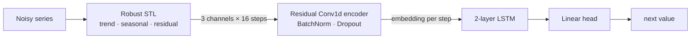

# NA-TSF: Robust Time-Series Forecasting under Training-Data Anomalies

M.Tech thesis project. NA-TSF forecasts a time series whose **training data is
corrupted by anomalies**: constant spikes, missing values and Gaussian
bursts. It decomposes the series and encodes it with a convolutional denoiser
before forecasting with an LSTM. It follows the experimental setup of
**RobustTSF** (Cheng et al., ICLR 2024) and is evaluated against its methods.

> **Status:** archived thesis code. Work continues on a successor project
> about noise-aware training across many corruption types.

## Method



1. **Decompose.** For each forecast, robust STL (`statsmodels`, `robust=True`)
   is fit on the **preceding `stl_context` points only** (default 64), and the
   last 16 steps are kept. This splits the anomaly-corrupted history into
   trend, seasonal and residual components without seeing the future. The
   robust LOESS iterations down-weight outliers, so anomalies end up mostly in
   the residual channel instead of distorting the trend and seasonality.
2. **Encode.** A small residual 1-D CNN (`RobustDenoiser`) maps the three
   component channels at each time step to a learned embedding. The network
   can learn to trust the trend and seasonal channels and discount anomalous
   residuals.
3. **Forecast.** A 2-layer LSTM over the 16-step embedding sequence, followed
   by a linear head, predicts the next value. Training uses an L1 loss.

Training is **fully deterministic**: seeded RNGs, deterministic cuDNN and
`torch.use_deterministic_algorithms`, so every run in the grid search can be
reproduced exactly.

## Experimental setup

Following RobustTSF: univariate `OT` column of **Electricity** and **Traffic**
(from the [Autoformer](https://github.com/thuml/Autoformer) benchmark),
70/30 train/validation split, input length 16, one-step-ahead forecasting.
Anomalies are injected into the training split only:

| Type | Corruption at a sampled point *x* |
|---|---|
| `const` | *x + 0.5* |
| `missing` | *≈ 0* (value dropped) |
| `gaussian` | *x + N(0, 0.5²)* |

Anomaly ratio ∈ {0.1, 0.3}. Hyperparameters (STL period, LSTM hidden size,
embedding size) are selected per setting by grid search.

To keep the comparison fair, NA-TSF and the baselines share:

- **identical anomalies**: the same injection routine and seed as RobustTSF's
  `dataset.py`, verified by a test;
- **the same supervision**: training targets come from the corrupted series;
- **train-only normalization**;
- **the same target positions** (minus a 48-step STL warm-up at the start of
  train);
- **strictly causal features**: a test checks that changing the target or any
  later value leaves the features unchanged.

Results are reported as mean ± std over 5 seeds.

## Thesis results (superseded protocol)

Validation **MAE / MSE** at the best epoch, as recorded in
[`results/final_results.ods`](results/final_results.ods). These come from
the original pipeline, before the protocol fixes above. In that pipeline,
NA-TSF's features used non-causal STL over the whole validation series, its
training targets were clean, and its scaler was fit on train + val. The
numbers are kept for reference:

| Dataset | Method | Clean | Const 0.1 | Const 0.3 | Missing 0.1 | Missing 0.3 | Gaussian 0.1 | Gaussian 0.3 |
|---|---|---|---|---|---|---|---|---|
| Electricity | LSTM | 0.182 / 0.070 | 0.191 / 0.077 | 0.206 / 0.086 | 0.205 / 0.086 | 0.225 / 0.092 | 0.199 / 0.080 | 0.210 / 0.086 |
| | RobustTSF | 0.177 / 0.065 | 0.177 / 0.066 | 0.183 / 0.070 | 0.181 / 0.068 | 0.194 / 0.074 | 0.176 / 0.067 | 0.177 / 0.067 |
| | **NA-TSF** | 0.123 / 0.046 | 0.127 / 0.052 | 0.146 / 0.054 | 0.125 / 0.152† | 0.141 / 0.059 | 0.126 / 0.050 | 0.130 / 0.054 |
| Traffic | LSTM | 0.194 / 0.105 | 0.209 / 0.123 | 0.231 / 0.136 | 0.266 / 0.170 | 0.295 / 0.208 | 0.216 / 0.140 | 0.233 / 0.158 |
| | RobustTSF | 0.185 / 0.100 | 0.198 / 0.110 | 0.203 / 0.111 | 0.200 / 0.113 | 0.243 / 0.140 | 0.185 / 0.101 | 0.202 / 0.116 |
| | **NA-TSF** | 0.158 / 0.085 | 0.169 / 0.090 | 0.196 / 0.111 | 0.172 / 0.092 | 0.208 / 0.115 | 0.165 / 0.087 | 0.179 / 0.104 |

† As recorded in the results sheet. This is likely a transcription error for 0.052.

Because of the leakage these numbers likely overstate NA-TSF's advantage, so
don't cite them as results. To get numbers under the fixed protocol, run
`scripts/run_all.sh`.

## Repository layout

```
na_tsf/
  train.py        # NA-TSF model, causal data pipeline, deterministic training, grid search
  analyze.py      # best config per setting, mean ± std over seeds, eval-command generation
scripts/
  run_all.sh      # full evaluation: tune -> 5-seed eval -> baselines (run on a server)
  get_baselines.sh  # fetch the official RobustTSF code (see below)
tests/
  test_protocol.py  # causality, baseline-identical anomalies, scaling, targets (no training)
results/
  final_results.ods # thesis results table (superseded protocol)
```

**Baselines.** The official
[RobustTSF code](https://github.com/haochenglouis/RobustTSF) is not
included, because the upstream repository has no license.
`scripts/get_baselines.sh` clones it into `baselines/robusttsf/` and points
its data paths at `data/`, which also fixes the undefined Traffic path. It
provides the vanilla LSTM, offline and online imputation, loss-based
selection, RobustTSF weighting, and DLinear baselines.

## Running

```bash
pip install -r requirements.txt
bash scripts/get_baselines.sh
mkdir data   # put electricity.csv and traffic.csv here (Autoformer benchmark files),
             # or point NA_TSF_DATA at another directory

# Full evaluation (NA-TSF tuning + 5-seed eval + baselines) -> results/
bash scripts/run_all.sh    # the default grid is 2,688 runs per dataset, so expect days of compute

# Or step by step
python na_tsf/train.py --dataset electricity --ano_type missing --ano_ratio 0.3 --out results/runs.csv
python na_tsf/train.py --dataset traffic --tune 1 --out results/tune_traffic.csv
python na_tsf/analyze.py results/tune_traffic.csv                  # best config per setting
python na_tsf/analyze.py results/tune_traffic.csv --commands 5     # 5-seed eval commands

pytest -q   # protocol tests, no training

# Baselines (run from the baseline folder)
cd baselines/robusttsf
python train_noisy.py           --loss mae --dataset ele --ano_type missing --ano_ratio 0.3
python train_noisy_weighting.py --loss mae --dataset ele --ano_type missing --ano_ratio 0.3   # RobustTSF
```

## Notes

- **Evaluation protocol.** An earlier version of this code built its features
  with STL over the whole validation series, trained on clean targets, and fit
  the scaler on train and validation together. These issues are fixed here
  (see *Experimental setup*), and `pytest` checks them. Numbers from the
  earlier pipeline are kept under *Thesis results* for reference only.
- **Not done here:** a held-out test split, significance tests, ablations, and
  benchmarks beyond Electricity and Traffic.

## Acknowledgements

The baselines, anomaly-injection protocol and datasets come from RobustTSF:

```bibtex
@inproceedings{cheng2024robusttsf,
  title     = {RobustTSF: Towards Theory and Design of Robust Time Series Forecasting with Anomalies},
  author    = {Hao Cheng and Qingsong Wen and Yang Liu and Liang Sun},
  booktitle = {International Conference on Learning Representations (ICLR)},
  year      = {2024}
}
```
